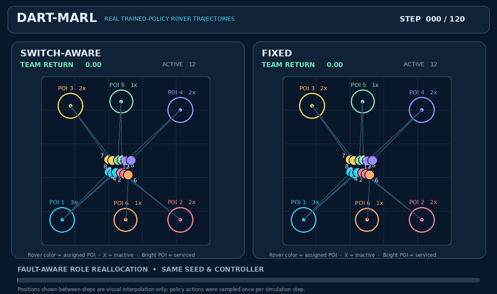
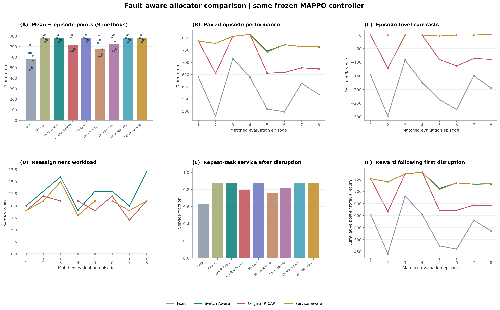
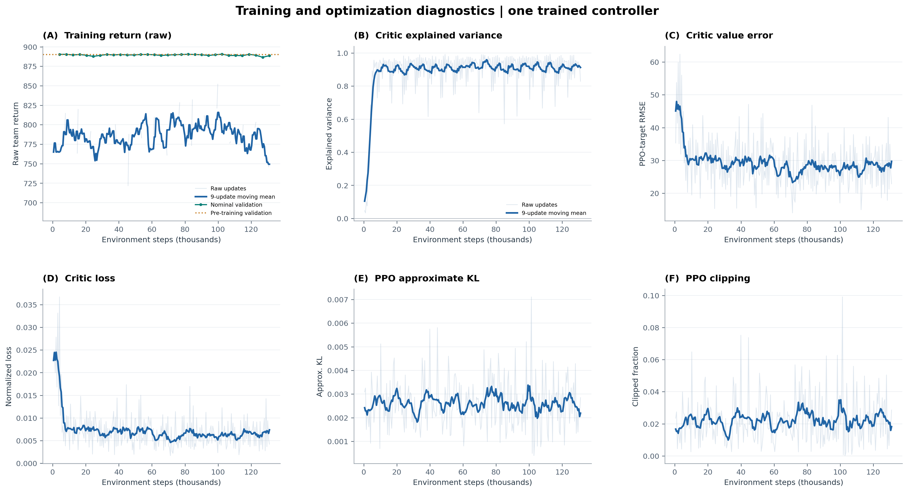

<div align="center">

# DART-MARL

### Disruption-Aware Role Transfer for Resilient Multi-Agent Reinforcement Learning

**A reproducible cooperative rover-team environment, trained MAPPO actor, and fault-aware role-allocation benchmark.**

[](https://www.python.org/)
[](LICENSE)

</div>



*Real 12-rover simulation: **Switch-Aware** (left) versus **Fixed roles** (right). Both panels use the **same trained actor, initial conditions, and fault schedule**. Only the allocation method changes. Display interpolation is not additional policy execution. One illustrative episode (returns 786.7 vs. 639.5), not an independent-seed statistical claim.*

## Overview

DART-MARL studies how cooperative teams of heterogeneous rovers respond to failures, delayed failure reports, capability changes, agent re-entry, and replacement. It combines a continuous 2D multi-rover environment, an explicitly role-guided MAPPO actor, and a family of role allocators. Each POI must be physically serviced by a capable coalition; changing a role label alone earns **no reward**.

The repository contains **reproducible code, trained actor exports, actual GIF/MP4 trajectories, raw results, vector figures, LaTeX tables, and integrity manifests**. It is suitable as a course-project implementation and experimental report. The evidence **does not establish superiority of original R-CART** over the Switch-Aware baseline.

## Video demonstrations

**Both included animations are 12-rover demonstrations.** The historical six-rover evaluation remains available as numerical data and reproducible code, but its older short videos are intentionally excluded to avoid confusion.


| Paired experiment | Animation | Video | Interpretation |
|---|---|---|---|
| **12 rovers: Switch-Aware vs. Fixed** | [GIF](media/rover_reallocation_vs_fixed_12.gif) | [MP4](media/rover_reallocation_vs_fixed_12.mp4) | Reallocation benefit in one example; 786.7 vs. 639.5 return |
| **12 rovers: Switch-Aware vs. original R-CART** | [GIF](media/rover_recovery_12.gif) | [MP4](media/rover_recovery_12.mp4) | Both achieve 786.7 in this selected episode; differences in some roles, not service |

The two **12-rover** demonstrations have 120 simulation decisions, ~89.5-second GIFs and ~91.9-second MP4 files. They show **12 initially active rovers, two reserved replacement slots, eight explicit disruptions and three automatic reentries**. Rovers can be disabled, so the active population need not remain 12. All motions are from one actor evaluation per simulation decision; intermediate frames only smooth playback. See [demo details](docs/DEMO.md).

## Main results

**Twelve-rover study:** One complete controller training run (seed `314159`, 131,072 environment steps), evaluated on **8 paired environmental episodes** using the same frozen actor. These are **descriptive** episode means, **not** training-seed confidence intervals.

| Allocator | Team return, mean | Role switches, mean |
|---|---:|---:|
| Fixed | 582.700 | 0.000 |
| Greedy | **778.575** | 13.875 |
| Switch-Aware | **778.575** | 12.625 |
| Original R-CART | 715.750 | 10.250 |
| R-CART No-Sync | 778.425 | 10.625 |
| R-CART No-Switch | 678.250 | 13.375 |
| R-CART No-Hysteresis | 727.150 | 13.625 |
| R-CART Bounded-Sync | 778.425 | 10.625 |
| R-CART Service-Aware | 778.425 | 10.625 |



*Eight paired episodes of **one** frozen controller; the displayed episode
variation is descriptive, not uncertainty across independently trained policies.*

The navigation-guided controller already performed well *before* PPO optimization: nominal mean team return was **890.075 initially** versus **888.600 in the final nominal evaluation** (on the configured validation episodes). The final PPO value explained variance was **~0.829**, but these results **do not demonstrate an improvement in team reward due to PPO**. The actor includes an **engineered navigation prior** and must not be described as learning navigation from scratch.

**Independent-seed historical study:** The separate **six-rover held-out evaluation** uses 10 independently trained fault-robust controllers: Switch-Aware **93.540** vs. original R-CART **91.418**, paired difference **-2.123**, with controller-level bootstrap interval approximately **[-5.160, +0.352]**. R-CART superiority was **not established**. The six- and twelve-rover raw returns have different scales and **must not be pooled**.

[Historical six-rover comparison (10 independent controllers per variant; PNG)](results/team12/paper_figures/historical_controller_pairs.png) · [vector PDF](results/team12/paper_figures/historical_controller_pairs.pdf)

The historical figure is **supplementary** and uses a different environment
and reward scale. It must not be pooled with the twelve-rover evaluation.

### Publication-grade multi-panel paper figures

**Preliminary training diagnostics** (blue curves, one twelve-rover training
seed) are retained for the paper. The critic's improvement must **not** be
read as proof of better task returns.



**Primary paper figures:**
[training / critic](results/team12/paper_figures/training_overview_2x3.pdf) ·
[allocator comparison](results/team12/paper_figures/allocator_comparison_2x3.pdf) ·
[recovery timeline](results/team12/paper_figures/recovery_timeline_2x3.pdf) ·
[historical controller pairs](results/team12/paper_figures/historical_controller_pairs.pdf).
The first three describe the twelve-rover study; the last is a **separate
historical six-rover study**. More detailed plots in
[`results/team12/figures`](results/team12/figures/) support the supplementary
analysis and manifest-checked reproducibility, so they are intentionally
retained rather than deleting experiment evidence.

The four figures are reproducibly generated **only from recorded data**, in
PNG, PDF, and SVG, with paired-episode CSV, LaTeX summary, captions and
source checksums. This adds **no new training** and makes no unsupported
statistical claim. See [publication figure suite](docs/PUBLICATION_FIGURES.md).

```bash
python scripts/make_publication_figures.py \
  --source results/team12 --out outputs/new_paper_figures
```

Full discussion: [12-rover findings](docs/RESULTS_12_ROVERS.md) · [original held-out study](docs/RESULTS.md) · [paper asset guide](docs/PAPER_ASSETS.md) · [multi-panel figures](docs/PUBLICATION_FIGURES.md).

## Quick start

Requires **Python 3.12+**. On Fedora or Ubuntu, install FFmpeg to render MP4. CUDA is optional; the included deterministic demos and tests run on CPU.

```bash
python -m venv .venv
source .venv/bin/activate
python -m pip install -e '.[dev,train,plots,demo]'
python -m pytest -q
```

**Recreate the 12-rover dynamic-vs-fixed demonstration** from the published, *actor-only* checkpoint, without downloading a full training snapshot. Running `python scripts/make_demo.py` with no flags now uses this 12-rover setup and writes to ignored `outputs/` files (never overwrites tracked media):

```bash
python scripts/make_demo.py \
  --checkpoint examples/checkpoints/team12_seed_314159.pt \
  --training-env-config configs/env/rover_team_12.yaml \
  --env-config configs/env/rover_team_12_showcase.yaml \
  --compare fixed --seed 901110 \
  --interpolation 4 --event-hold 4 --frame-ms 175 \
  --out outputs/demo_fixed.gif \
  --mp4 outputs/demo_fixed.mp4 \
  --trace outputs/demo_fixed_trace.json
```

For the same-episode **Switch-Aware vs. original R-CART** comparison, change `--compare fixed` to `--compare r_cart`. Run `python scripts/make_demo.py --help` for playback settings.

**Recompute the reported paired allocator experiment** with the bundled 12-rover actor:

```bash
python -m dart_marl evaluate-allocators \
  --env-config configs/env/rover_team_12_showcase.yaml \
  --controller checkpoint \
  --checkpoint examples/checkpoints/team12_seed_314159.pt \
  --training-env-config configs/env/rover_team_12.yaml \
  --methods fixed greedy switch_aware r_cart r_cart_no_sync \
            r_cart_no_switch r_cart_no_hysteresis \
            r_cart_bounded_sync r_cart_service \
  --episodes 8 --seed 901110 --device cpu \
  --out outputs/replication_12
```

Reevaluation across all nine methods is **CPU-intensive**. If rerunning the full workflow from new local training, use [the resumable evaluation pipeline](docs/TWELVE_ROVER_WORKFLOW.md).

**Regenerate publication figures and LaTeX tables** from the included raw source data:

```bash
python scripts/make_paper_assets.py \
  --training results/team12/data \
  --evaluation results/team12/data/allocator_report.json \
  --trace media/rover_recovery_12_trace.json \
  --historical-csv results/heldout_episode_returns.csv \
  --out outputs/reproduced_paper_assets
```

Each plotted input and output is hashed in the generated `manifest.json`. The supplied final paper figures are under [`results/team12/figures`](results/team12/figures/) in PNG, vector PDF, and SVG; tables are under [`results/team12/tables`](results/team12/tables/).

## Re-train on 12 rovers

```bash
python -m dart_marl train \
  --config configs/train/mappo_12_rovers.yaml \
  --out outputs/team12_training
bash scripts/build_final_artifacts.sh \
  outputs/team12_training outputs/team12_publication
```

The included `examples/checkpoints/team12_seed_314159.pt` is an **actor-only evaluation export** with bit-identical actor tensors to the completed user-provided checkpoint. It has no optimizer or collector state and **cannot resume PPO**. To resume your own training, preserve your locally generated full `checkpoints/latest.pt` and use the documented resume command. The recorded evaluation and demo were produced with the original full checkpoint: its SHA-256 differs from the actor-only export because non-actor state has been removed. Both identities are recorded in [`results/team12/provenance.json`](results/team12/provenance.json).

## Layout

```text
DART-MARL/
├── configs/                # Environments, training settings, study protocols
├── src/dart_marl/          # Rover mechanics, MAPPO, allocation, recovery, CFT
├── scripts/                # Reproducible demo, evaluation, tables and figures
├── tests/                  # Regression and provenance tests
├── examples/checkpoints/  # Verified actor-only exports (6- and 12-rover)
├── media/                 # Real-policy GIF/MP4 demos + raw traces
├── results/               # Historical independent-seed and new 12-rover data
└── docs/                  # Methods, limitations, reproducibility, workflows
```

[Architecture](docs/ARCHITECTURE.md) · [Results and limitations](docs/RESULTS.md) · [12-rover results](docs/RESULTS_12_ROVERS.md) · [Demo](docs/DEMO.md) · [Reproducibility](docs/REPRODUCIBILITY.md) · [Training workflow](docs/TWELVE_ROVER_WORKFLOW.md)

## Scientific and software boundaries

- The controller is MAPPO **with an engineered role-navigation prior**, not unmodified vanilla MAPPO.
- Team reward requires **physical** POI coalition service. Assignment itself has no direct reward.
- The allocator receives the roster and physical telemetry defined by this simulator; do **not** claim a purely decentralized allocator or hidden-state-free fault inference.
- Eight paired **environment episodes on one trained controller** are not eight independent policy-training seeds. No 12-rover training-seed confidence interval is claimed.
- Original R-CART **underperforms** a simpler baseline in this 12-rover study, while some of its ablations approximately tie that baseline.
- The six-rover held-out results are already examined and are **not fresh blind confirmation** of subsequently adjusted methods.
- No result here establishes universal R-CART superiority; the project is a reproducible class and research exploration, **not** a validated AAMAS-level performance claim.

## License and attribution

MIT, see [LICENSE](LICENSE). Citation metadata and authors appear in [CITATION.cff](CITATION.cff). Rover Domain mechanics were adapted and expanded with the instructor's permission; upstream attribution and redistribution rights should be reviewed if upstream code is separately re-published.
