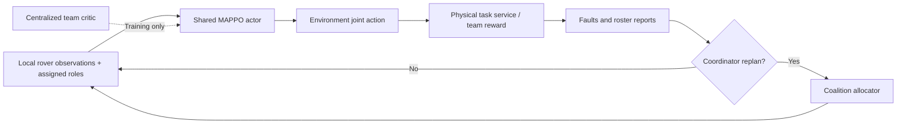

# System architecture

## Simulation contract

`RoverEnv.reset(seed)` starts a seeded, finite-horizon episode. At every decision boundary, each physically active rover receives local directional-sensor and role-target observations. The shared MAPPO actor emits a two-dimensional bounded continuous control. The environment advances one synchronized step, evaluates actual POI service, distributes one shared team reward, and applies any boundary disruptions before the next observation. A coordinator may then replan using **reported** roster state (subject to detection delay). `env.active` is used to filter impossible actuation, not as an oracle planning trigger.

**POI coupling:** a task requiring two rovers is served only when at least two eligible physical rovers are inside its service radius at that time; roles are steering instructions and not substitutes for physical occupancy.

## Data flow

## Controller

The shared policy receives local observations and its assigned goal. In the role-guided variants, `role_navigation_prior` adds a deterministic target-relative bias to the actor's Gaussian mean **inside the policy distribution**. PPO log-probabilities account for this prior. The team critic uses centralized training state. Fault-diverse training changes the environment's training-event distribution, not the runtime allocator's information boundary.

The bundled `.pt` demonstration files export **actor weights only**, with training-environment SHA and seed. They are deliberately small and load through `torch.load(..., weights_only=True)`.

## Allocation methods

- **Fixed** retains original role assignments.
- **Greedy** selects feasible coalitions using projected value/travel.
- **Switch-Aware** optimizes an additive coalition surrogate, penalizing role changes.
- **R-CART** forecasts finite-horizon coalition service opportunity, travel, synchronization and switching with hysteresis. Original raw synchronization can double-charge arrival delay and cause harmful reallocation.
- **Bounded-Sync / No-Sync / No-Switch / No-Hysteresis** isolate components of R-CART.
- **Service-Aware** replaces the extra synchronization penalty with explicit estimated service under multiple speed assumptions; it has not shown independent superiority.
- **CFT / Ranking CFT** learn candidate future-return corrections from cloned counterfactual rollouts. They are controller-specific and should never be transferred across unrelated checkpoints.

## Evaluation

All compared allocators use the **same** frozen actor, initial seed and fault tape for each paired episode. Results are aggregated within controller first; independent controller-training seeds are the units for confidence intervals. Test-only scenarios are withheld during tuning when conducting a new study. Results of the already-completed historical test are published in `results/` and **must not** be reused for new method selection.
