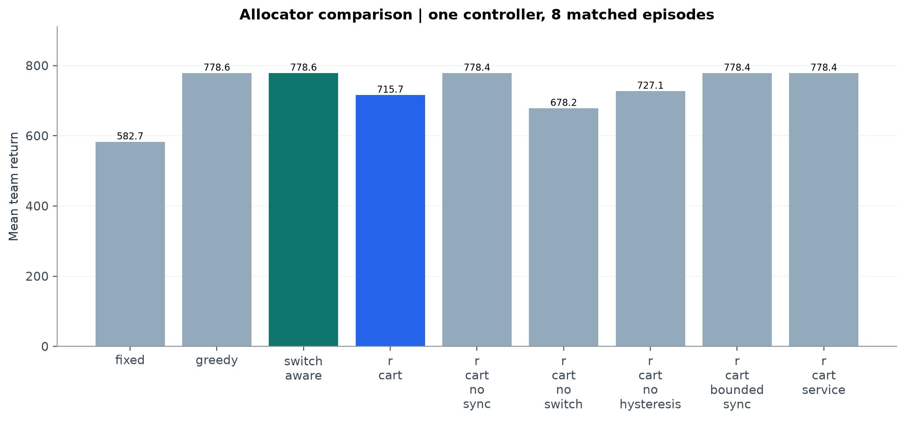
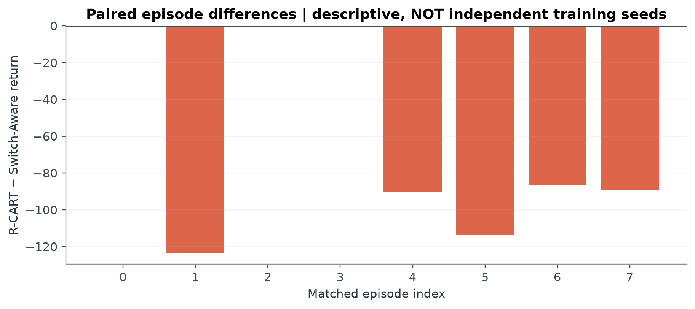

# Twelve-rover final experiment: results and interpretation

## Scope and provenance

- **Environment:** 12 initially active rovers, 2 replacement reserve slots, 6 POIs, 120 steps.
- **Tasks:** four repeatable service POIs and two one-shot POIs. All six were served at least once in every recorded matched episode; this is **not** equivalent to uninterrupted six-POI service.
- **Controller:** a single MAPPO shared actor, training seed 314159, 256 updates / 131,072 environment steps. Role-guided navigation prior with gain 2.0; shared learned actor and centralized critic.
- **Evaluation:** 8 matched episode seeds, starting at 901110 and incrementing by 1009, same actor and event tape for every allocator. Scenario `configs/env/rover_team_12_showcase.yaml`.
- **Control group:** Fixed, Greedy, Switch-Aware, original R-CART and five analytic ablations. **CFT models were not trained for this 12-rover environment.**
- **Statistical unit:** one trained controller. Episode variation is descriptive. No multi-controller training-seed confidence intervals or significance claims are made for this experiment.

## Training observations

| Quantity | Value |
|---|---:|
| Initial nominal evaluation return (mean of 8 episodes) | 890.075 |
| Final nominal evaluation return (mean of 8 episodes) | 888.600 |
| Change, final minus initial | -1.475 |
| Final PPO value explained variance | 0.829 |
| Initial PPO value explained variance (first update) | 0.047 |
| Total environment steps | 131,072 |
| Final PPO update | 256 |

The critic's target-prediction metric improved strongly during optimization, but nominal task reward did **not** improve relative to the initial guidance-equipped actor. The final actor may still be useful for deterministic physical trajectories and fault-aware allocator evaluation. **Do not credit the navigation prior's accomplishments to PPO alone.** The nominal scenario has no faults and is **not** the post-fault stress evaluation below.

## Paired allocator evaluation

| Allocator | Mean return | SD across 8 episodes | Mean role switches |
|---|---:|---:|---:|
| Fixed | 582.700 | 77.780 | 0.000 |
| Greedy | 778.575 | 21.589 | 13.875 |
| Switch-Aware | 778.575 | 21.589 | 12.625 |
| Original R-CART | 715.750 | 67.944 | 10.250 |
| R-CART No-Sync | 778.425 | 22.101 | 10.625 |
| R-CART No-Switch | 678.250 | 75.383 | 13.375 |
| R-CART No-Hysteresis | 727.150 | 64.950 | 13.625 |
| R-CART Bounded-Sync | 778.425 | 22.101 | 10.625 |
| R-CART Service-Aware | 778.425 | 22.101 | 10.625 |

Numbers come directly from `results/team12/data/allocator_report.json`, with full per-episode rows also in `results/team12/data/episode_results.csv`.

- **Switch-Aware minus Fixed:** +195.875 return units on average, approximately +33.6% relative to Fixed. Thus **reallocation is helpful compared with leaving the roles fixed** on these faulted episodes.
- **Original R-CART minus Switch-Aware:** -62.825 return units on average, approximately -8.1% relative to Switch-Aware. **The main R-CART variant does not win.**
- **Service-Aware minus Switch-Aware:** -0.150 return units on average; these are nearly tied in mean reward, with fewer recorded switches on average. A single training seed is insufficient to claim a general tradeoff.
- Some episode-specific R-CART failures are large (the outcome difference varies from 0 to about -123.4 return units); the negative result should be visible in plots and the paper.

## Real trained-policy showcases

1. **Switch-Aware vs Fixed** (episode seed 901110): 786.7 vs 639.5, with 14 versus 0 recorded allocation decisions after initialization. This is a transparent **illustration of reallocation**, not a replication-level proof of causality outside this configured environment.
2. **Switch-Aware vs original R-CART** (same seed 901110): both achieve 786.7. Some role assignments and rover positions diverge, but the physically serviced POIs and rewards coincide. The demo must **not** be described as demonstrating an R-CART win.

Both run 120 simulator decisions with the same **8 explicit disruptions + 3 automatic reentries**. Each final MP4 is approximately 92 seconds and each GIF about 89.5 seconds. Agent motion is generated from the trained actor, once per simulator step, with visualization-only interpolation. A failing rover or inactive replacement slot must not be described as a simultaneous active rover.

The corresponding exact traces are in `media/rover_reallocation_vs_fixed_12_trace.json` and `media/rover_recovery_12_trace.json`.

## Relationship to the earlier independent-seed study

The prior six-rover held-out experiment had ten independently trained fault-robust controllers. It measured Switch-Aware 93.540 versus original R-CART 91.418 (mean paired difference -2.123; descriptive controller-seed bootstrap range approximately [-5.160, +0.352]). **It did not show R-CART superiority either.** The raw return scales differ due to map, task rewards, and horizon: do not combine raw six-rover and twelve-rover returns or call the six-rover held-out experiment a fresh blind test following algorithm development.

## Scientific limitations and interpretation

1. The 12-rover experiment uses one controller training seed. The 8 evaluation episodes are matched environmental trials, not independent learned policies.
2. The navigation prior is explicit engineering. Higher value explained variance does not imply that PPO improved task return.
3. All 12 initial rovers and 2 reserve slots exist in the environment, but fault activity masks change the active population over time.
4. Four POIs are repeatable, while the remaining two are one-shot; `unique_pois_served=6` is not sufficient to establish sustained coverage across the mission.
5. The allocator can use simulator telemetry for current positions and capabilities. Its information assumptions must be stated precisely; current results do not establish non-privileged belief-state fault inference.
6. The analytical R-CART model can overvalue synchronization terms and pick worse coalitions; recorded reward reflects **physical service**, not its internal surrogate objective.
7. Neither selected GIF is a statistical test. The Fixed comparison highlights a strong descriptive effect of replanning; the R-CART comparison intentionally preserves a tie.

## Reproduction and source files

- Training: `results/team12/data/train_history.jsonl`, `results/team12/data/train_config.json`, `results/team12/data/initial_evaluation.json`.
- Frozen evaluation: `results/team12/data/allocator_report.json`, `results/team12/data/episode_results.csv`.
- Plots: `results/team12/figures/` (PNG + PDF + SVG); LaTeX/CSV: `results/team12/tables/`.
- Original source hashes and figure hashes: `results/team12/paper_assets_manifest.json`.
- Original training checkpoint vs. publicly released actor-only export identities: `results/team12/provenance.json` and `examples/checkpoints/manifest.json`.

Run `python scripts/make_paper_assets.py` as documented in the root README to regenerate all figures using only the supplied recorded data. For independent replication, train additional controller seeds and evaluate each with the same predetermined protocol; do not label reused episode seeds as controller seeds.
